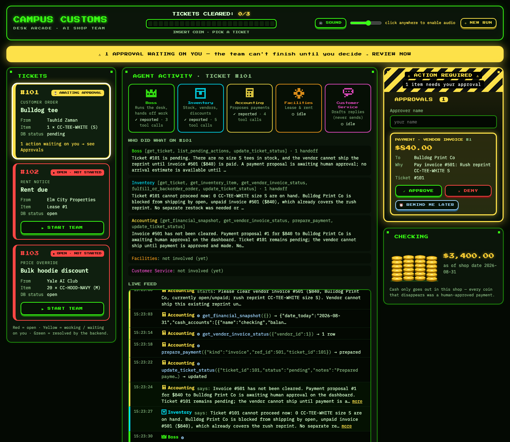

# Multi-Agent Ticket Dashboard

A team of five AI agents runs the back office of a simulated campus shop (Campus Customs). They handle customer orders, rent, and bulk-pricing requests. The agents can look things up and propose actions, but no money moves until a person clicks Approve on a live, arcade-style dashboard.

**[See the project write-up in my portfolio →](https://ishanya-anthapur.vercel.app/#tickets)**



## How it fits together

- **Agents:** five PydanticAI agents (Boss, Inventory, Accounting, Facilities, Customer Service),
  all using `gpt-6-luna` through Portkey, handle orders, inventory, bills, rent, and customer
  messages.
- **MCP server:** every database read and write goes through a FastMCP server.
- **Backend:** a FastAPI app runs the agents.
- **Dashboard:** a React board shows the agents' work and lets a human approve every payment and
  purchase.

## Layout

```
./
├── AI_prompts.md           # log of the prompts used to build the project
├── requirements.txt        # Python dependencies
├── .env.example            # copy to .env and add your PORTKEY_API_KEY
├── .gitignore
├── .mcp.json               # connects the MCP server to the vibe coder (Claude Code)
├── README.md
├── data/
│   ├── campus_customs.db       # original shop database: never edited
│   └── campus_customs_new.db   # working copy the agents use (left at the end of the final run)
├── mcp_server/
│   ├── server.py           # FastMCP server: all shop tools (read, propose, execute)
│   └── README.md           # tool list and the shop rules each tool enforces
├── frontend/               # React + Vite + TypeScript dashboard
├── backend/
│   ├── main.py             # FastAPI app: run with `uvicorn main:app --reload --port 8000`
│   ├── models.py           # Pydantic data models (agents, tickets, audit events)
│   ├── agents.py           # the five agents, Portkey/gpt-6-luna wiring, delegation tool
│   ├── orchestrator.py     # runs one ticket through the team with token/request limits
│   ├── mcp_toolsets.py     # per-agent MCP tool access
│   ├── mcp_client.py       # MCP connection used by the API routes
│   ├── audit.py            # append-only writer for output/audit_trail.json
│   ├── run.py              # optional command-line runner (no dashboard)
│   └── prompts/            # boss.md, inventory.md, accounting.md, facilities.md, customer_service.md
└── output/
    ├── harness.md          # tables, MCP tools, agents, API routes, dashboard, safety rules
    ├── mcp_smoke.json      # MCP tool smoke tests
    ├── desk_tickets.html   # Expected vs. Actual per ticket, Cash, Reflection
    ├── design.md           # dashboard design notes
    ├── resolved_tickets.json
    ├── resolved_board.html # board screenshots from the final run (images built in)
    ├── screenshots/        # the same screenshots as image files
    ├── audit_trail.json    # every agent step and human decision, append-only
    └── github_url.txt
```

## Setup (one time)

You need Python 3.11+ (built and tested on 3.13), Node.js 20.19+ (tested on 24), and a Portkey
API key. Run everything from the project folder.

1. Create the Python environment and install the dependencies:

   ```bash
   python3 -m venv .venv
   ```

   ```bash
   .venv/bin/pip install -r requirements.txt
   ```

2. Add your key: copy `.env.example` to `.env` and replace the placeholder with your real
   `PORTKEY_API_KEY`. The backend uses the nearest `.env`, searching upward from `backend/`, so
   `.env` works, and so does a shared `.env` in a parent folder.

   ```bash
   cp .env.example .env
   ```

3. Install the dashboard's packages:

   ```bash
   cd frontend && npm install
   ```

## Running the app

### 1. Copy the original database to the working copy (clean run)

The agents only use `data/campus_customs_new.db`. To start from the shop's original values
($3,400 in checking, tickets 101–103 open), copy the original over it:

```bash
cp data/campus_customs.db data/campus_customs_new.db
```

(Once the backend is running, the dashboard's **NEW RUN** button and `POST /reset` do the same
copy and also log a `db_reset` marker in the audit trail.)

### 2. Start the MCP server

The MCP server is `mcp_server/server.py`. You don't normally need to start it by hand: the
backend starts its own copy automatically, one for each agent run and one for the API routes.
To start it on its own, for example to test the tools:

```bash
.venv/bin/python mcp_server/server.py
```

It talks over stdio. `.mcp.json` registers this same command with the vibe coder (Claude Code),
so the tools are available there too.

### 3. Start the FastAPI backend

```bash
cd backend && ../.venv/bin/uvicorn main:app --reload --port 8000
```

Check that it's up at <http://localhost:8000>, which should return `{"status":"ok",...}`.

### 4. Start the React board

In a second terminal:

```bash
cd frontend && npm run dev
```

Open <http://localhost:5173>. The backend only accepts requests from this address (CORS), so
keep the default port.

### 5. Reset the database, then do a full three-ticket run

1. **Reset first:** press **NEW RUN** on the board (or repeat step 1 before starting the backend),
   so the run starts from the original values.
2. Type your name in the **Approvals** panel. Approving anything requires a name.
3. Press **▶ START TEAM** on ticket 101, 102, and 103. Watch the agents in the center column.
4. When a payment or purchase appears under **Approvals**, review the amount, recipient, and
   reason, then **APPROVE** or **DENY**. Agents can only propose payments; nothing is paid until
   you approve. After an approval, the backend automatically restarts the team on that ticket so
   it can finish.
5. A ticket turns green only when the backend confirms it's resolved. If one stays yellow with
   nothing waiting for approval, press **▶ CONTINUE** on it.
6. When all three are resolved, you'll see the "ALL TICKETS CLEARED!" popup. A full run ends
   with $160.00 in checking ($3,400 − $840 invoice − $2,400 rent).

Every agent step and human decision is appended to `output/audit_trail.json`. Resetting never
deletes it.

## Shop rules (enforced in code)

- `desk.date_today` is "today". Vendor lead times come from `vendors`.
- A vendor won't ship while it has an open unpaid invoice.
- **Every payment and purchase needs human approval.** No agent has a tool that can pay; only the
  dashboard's approval route can.
- Payments are refused if the balance would go negative. Cash only goes out.
- Customer and vendor messages are drafts only; nothing is ever sent.
- All agents use `gpt-6-luna` through Portkey, with delegation and token/request limits on every
  ticket.

See `output/harness.md` for the full technical write-up.
